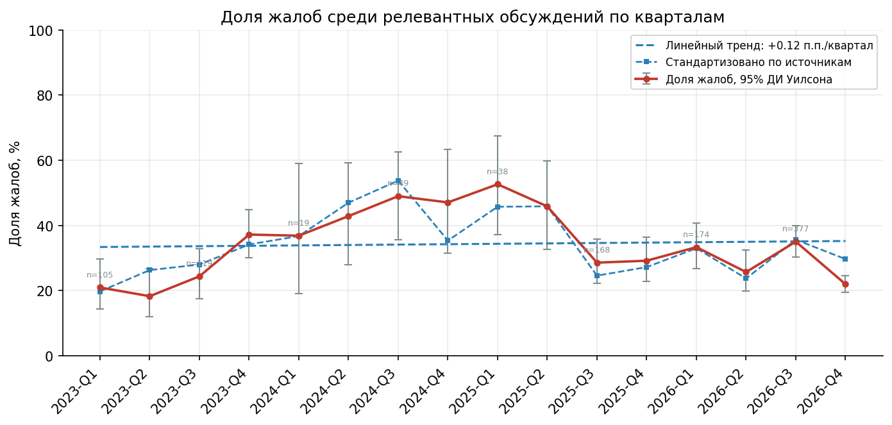
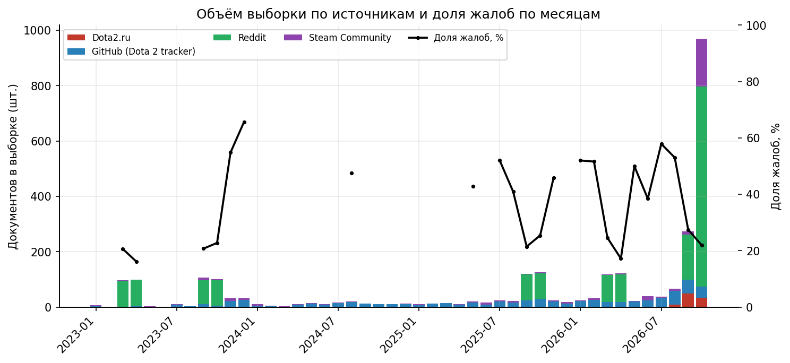
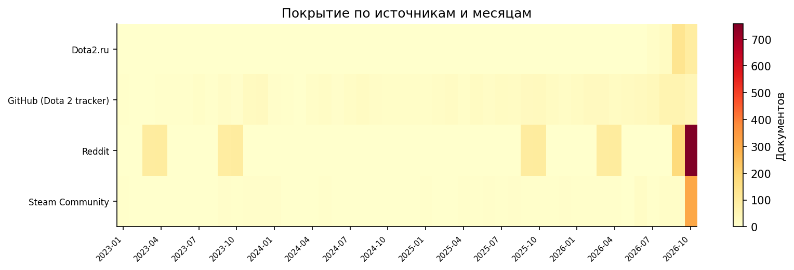
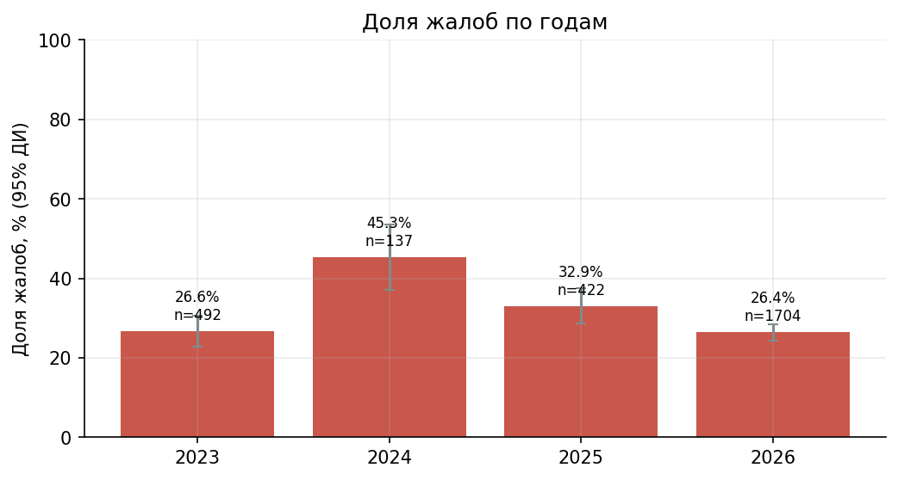
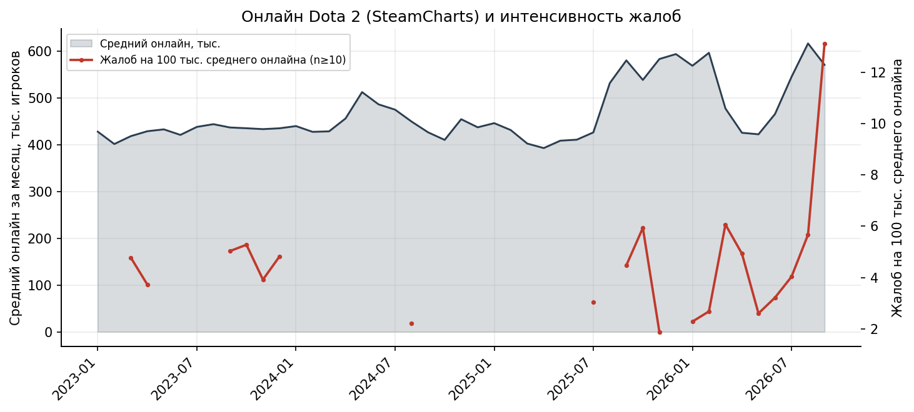
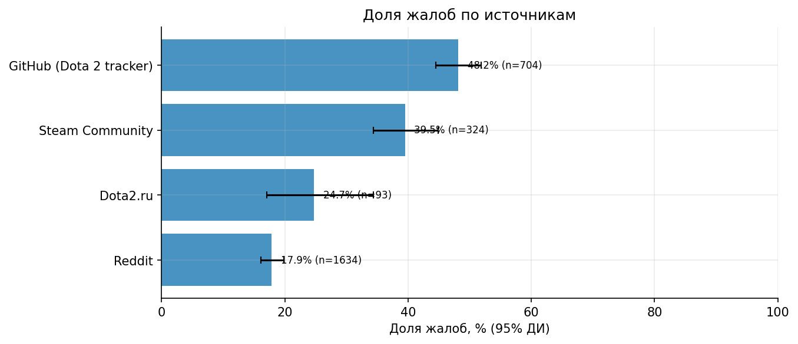
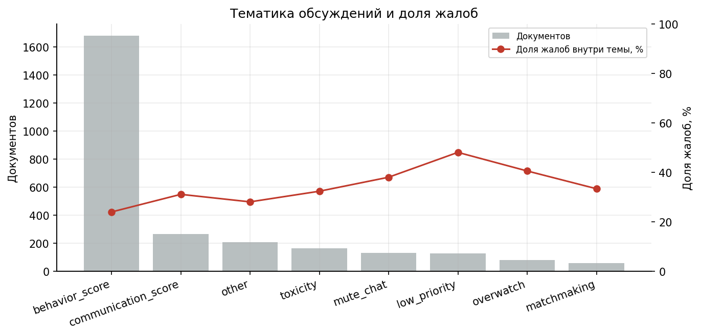
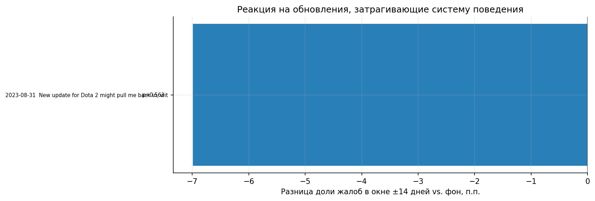
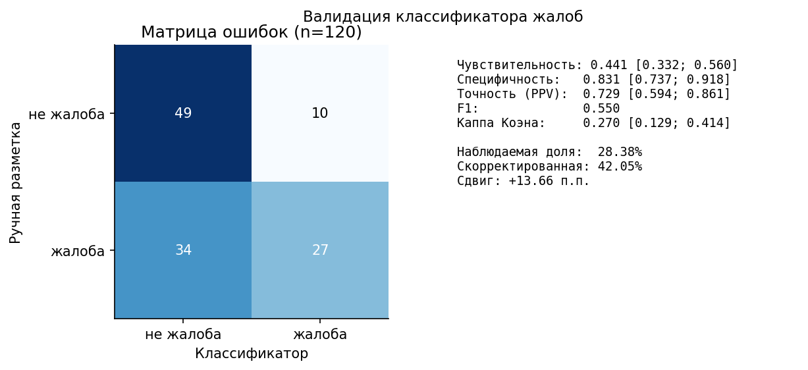

# Жалобы игроков Dota 2 на систему порядочности и вежливости

## Комплексный анализ интернет-ресурсов: методы, данные, погрешности

**Дата формирования отчёта:** 2026-10-24T16:05:27+00:00<br>
**Период анализа:** 2023-01-03 — 2026-10-23<br>
**Корпус:** 3 264 документов, из них релевантных — 2 755<br>
**Источников:** 4

> Отчёт полностью воспроизводим: все исходные ответы API закэшированы в `data/cache/`, классификация и статистика пересчитываются командами из раздела «Воспроизводимость». Скрипт `scripts/verify.py` сверяет ключевые числа отчёта с пересчётом из данных.

## 1. Краткое резюме

1. Калиброванная (по ручной разметке) доля жалоб среди релевантных обсуждений — **50.8%**, 95% ДИ 42.7–58.8%; классификатор без калибровки даёт 28.4% (95% ДИ 26.7–30.1%).
2. Общий и стандартизованный по платформам тренд статистически незначим: OLS +0.12 п.п./квартал (p=0.874); по составу источников +0.03 (p=0.96); GitHub+Steam +0.09 (p=0.747).
3. Изменение с первого по последний квартал: **+1.0 п.п.** (21.0% → 22.0%).
4. Сравнение первого и последнего года: разница -0.2 п.п. (95% ДИ -4.7…+4.2 п.п.; p=0.923).
5. Связь доли жалоб со средним онлайном: ρ Спирмена = +0.086 (p=0.574, n=45 мес.).
6. Валидация на ручной разметке (n=120): чувствительность 0.441, специфичность 0.831, каппа Коэна 0.270. Калиброванная (стратифицированная) оценка доли жалоб: 50.8% (95% ДИ 42.7–58.8%), против 28.4% у классификатора.
7. Суммарная **наихудшая** погрешность калиброванной оценки: ±32.8 п.п. → интервал 18.0%…83.6% (разложение по компонентам — раздел 7).

## 2. Задача, гипотезы и границы анализа

**Задача.** Выявить тенденцию жалоб пользователей на систему порядочности и вежливости в Dota 2 (Behavior Score, Conduct Summary, Communication Score, Low Priority, Overwatch, система репортов) по публичным высказываниям в социальных сетях, на форумах и в трекерах, с количественной оценкой погрешности.

**Проверяемые гипотезы:**

- **H1 (тренд).** Доля жалоб среди релевантных обсуждений растёт со временем.
- **H2 (события).** Вокруг обновлений, затрагивающих систему поведения, доля жалоб выше фоновой.
- **H3 (масштаб).** Интенсивность жалоб на 100 тыс. среднего онлайна не постоянна и не объясняется только онлайном.
- **H4 (источники).** Доля жалоб систематически различается между платформами (платформенная селекция).

**Что входит в понятие «система порядочности и вежливости»:** Behavior Score и Conduct Summary, Communication Score, Low Priority, Overwatch, репорты/коммендации, мьюты и баны за поведение. Токсичность и смурфинг включаются только когда они обсуждаются в связке с этими механиками (иначе это шум, а не жалоба на систему).

**Границы:** анализ не измеряет объективное качество матчмейкинга и не проверяет, справедливы ли конкретные баны. Он измеряет **публичную реакцию** и её динамику; это прокси-показатель, а не аудит Valve.

## 3. Источники и охват

Сбор вёлся только по публичным страницам и API, с указанием исследовательского User-Agent, задержками между запросами и кэшированием. Там, где платформа отдавала 429/403/капчу, источник помечался как недоступный и **не** заменялся суррогатом.

| Источник | Документов | Первое | Последнее | Месяцев с данными |
|---|---|---|---|---|
| Reddit | 1 714 | 2023-03-19 | 2026-10-23 | 10 |
| GitHub (Dota 2 tracker) | 812 | 2023-01-08 | 2026-10-22 | 44 |
| Steam Community | 478 | 2023-01-03 | 2026-10-23 | 42 |
| Dota2.ru | 260 | 2026-07-31 | 2026-10-23 | 4 |

**Доступность поисковых систем** (аудит охвата; фиксировались только факты блокировки):

| Поисковик | Запросов | Заблокировано | Итог |
|---|---|---|---|
| bing | 8 | 0 | доступен |
| duckduckgo | 8 | 8 | заблокирован |
| google | 8 | 8 | заблокирован |
| yandex | 8 | 8 | заблокирован |

**Важно:** Google и Яндекс при automated-доступе отдают consent/captcha, поэтому их выдача не использовалась как корпус — только как индикатор доступности. Bing/DuckDuckGo использовались для обнаружения URL, а не для подсчёта частот (частоты SERP не репрезентативны).

**Ограничение покрытия Reddit.** Из-за серверных таймаутов архива (422) и антибот-лимитов данные есть только за 10 месяцев (5 кварталов); кварталы 2024 года представлены слабо. Это снижает точность квартальных оценок и делает годовые сравнения чувствительными к пропускам — выводы о тренде сформулированы с этой оговоркой.

**Качество выдачи Bing.** Для части русскоязычных запросов Bing возвращал нерелевантные результаты (проверено вручную), поэтому поисковики использовались только как аудит доступности, а не как источник корпуса.

**Reddit.** Основной канал — Arctic Shift (публичный архив Reddit). Полнотекстовый поиск по комментариям выполнялся по фразам (`behavior score`, `conduct summary`, `low priority`, `рейтинг поведения`, `репорт` и др.) в r/DotA2 и r/TrueDoTA2. Дополнительно — RSS-поиск Reddit для постов (ограничен антибот-политикой Reddit).

**Steam Community.** Поиск по обсуждениям Dota 2 (appid 570): заголовки и сниппеты результатов поиска; для части тем (48 из 180 запланированных) выгружены полные тексты, остальные остановлены лимитом 429. **GitHub.** Официальный трекер `ValveSoftware/Dota2-Gameplay` (dev.dota2.com перенесён туда) — поиск issues по тем же формулировкам. **Dota2.ru** — русскоязычный форум (разделы «Общие вопросы», «Обитель нья», «Патчи и ивенты», «Тех. поддержка»).

**Статистика онлайна.** SteamCharts (средний и пиковый онлайн по месяцам), Steam Web API (текущий онлайн), Steam News API (даты обновлений). SteamDB отдаёт 403 (Cloudflare) — использован как перекрёстная проверка доступности, не как источник чисел.

## 4. Методология

### 4.1. Дизайн выборки

План сбора Reddit задавал до 100 совпадений для каждой комбинации «субреддит × поисковая фраза × квартал» с чередованием сортировки desc/asc. Из 144 плановых ячеек ответили 10; чтобы не повторять запросы и не расходовать лимиты, дополнительно извлечены 755 уникальных комментариев из 26 уже сохранённых успешных HTTP-ответов предыдущих конфигураций. Итоговый Reddit-корпус — дедуплицированное объединение этих результатов, а не вероятностная выборка с известной вероятностью включения.

Важное следствие: сортировка desc/asc берёт **границы** временных окон, а не случайные даты; месячное распределение смещено к первым/последним месяцам, а часть месяцев отсутствует. Поэтому абсолютные объёмы Reddit не являются оценкой общего числа жалоб, а временные ряды трактуются как описательные. Для тренда дополнительно показаны стандартизация по платформам и контроль на GitHub+Steam с более сплошным покрытием.

Ограничение дизайна: при >100 совпадениях в одной ячейке планировалось брать только 100. Доля жалоб поэтому описывает найденный корпус и может смещаться из-за различий в запросах, периодах и доступности API; доверительный интервал не устраняет эту систематическую ошибку.

Steam/GitHub/Dota2.ru — сплошной отбор по поисковым запросам с ограничением числа страниц/тем; для Steam тексты тем догружались полностью (OP + комментарии).

### 4.2. Очистка и дедупликация

- Удалено коротких (<20 символов) и пустых: 59
- Спам/ботоподобные: 26
- Точные дубликаты: 41
- Near-duplicates (MinHash, Jaccard ≥ 0.90): 91
- После очистки: **3 264** документов; релевантных: **2 755**.

### 4.3. Классификация

Классификатор — прозрачный лингвистический (rule-based), а не «чёрный ящик»: словари кондуктивных терминов, негативной/позитивной лексики, шаблоны жалоб и вопросов, определение темы по группам ключевых слов. Это позволяет проверить любое решение вручную и не зависит от внешних ML-сервисов.

Классы тональности: `complaint` (жалоба), `question` (вопрос/уточнение), `neutral` (описание без оценки), `positive` (одобрение), `off_topic` (нерелевантно). **Жалоба** = релевантный текст с негативной лексикой и/или жалобным паттерном («снизился без причины», «забанили за репорт», «система не работает», «valve игнорирует» и т.п.).

### 4.4. Статистические методы

- Доли — с **интервалом Уилсона** (95%), а не нормальным приближением: устойчиво при малых n.
- **Дизайн-эффект** из ICC по кластерам «источник + автор»: комментарии одного автора не независимы.
- **FPC** (finite population correction) — там, где известен размер генеральной совокупности.
- Тренд — тест **Манна–Кендалла** + OLS с **HAC (Newey–West)** ошибками + bootstrap-ДИ наклона.
- Сравнение долей — z-тест и χ²; события — разность долей «окно ±14 дней» vs фон.
- Коррекция систематической ошибки классификатора — **Роган–Глэден**: `p_true = (p_obs + spec − 1) / (sens + spec − 1)`.

### 4.5. Формулы погрешности

```text
Wilson:  (p + z²/2n ± z·√(p(1−p)/n + z²/4n²)) / (1 + z²/n)
FPC:     half_width · √((N − n)/(N − 1))
ICC:     ρ = (MSB − MSW) / (MSB + (m̄ − 1)·MSW)
Deff:    deff = 1 + (m̄ − 1)·ρ ;  n_eff = n / deff
Rogan–Gladen: p_true = (p_obs + spec − 1)/(sens + spec − 1)
Наихудшее смещение неответа: ≤ nonresponse_rate · max(p, 1 − p)
```

## 5. Результаты

### 5.1. Общая доля жалоб

- Релевантных документов: **2 755**; жалоб: **782**.
- Доля жалоб: **28.4%**, 95% ДИ Уилсона 26.7–30.1%.
- С поправкой на дизайн-эффект (deff = 1.082): 29.0–32.5%; эффективный n ≈ 2546.6.
- ICC по кластерам «источник+автор» = 0.1843, средний размер кластера = 1.44.
- **Калиброванная оценка с учётом ошибки классификатора: 50.8% (42.7–58.8%); расчёт — раздел 6.2.**

### 5.2. Динамика



*Рис. 1. Доля жалоб по кварталам с 95% ДИ и линейным трендом*



*Рис. 2. Объём выборки по источникам и доля жалоб по месяцам (месяцы с n<20 не показаны)*



*Рис. 3. Покрытие источников по месяцам (сколько документов попало в выборку)*


- Манн–Кендалл: S = 6, τ = 0.05, z = 0.225, p = 0.822 → **значимого тренда нет**.
- OLS: +0.12 п.п./квартал (HAC SE 0.76 п.п.; 95% ДИ -1.36…+1.61; p = 0.874).
- После стандартизации по составу источников (устранение сдвига платформ): наклон +0.03 п.п./квартал (p=0.96), Манн–Кендалл: значимого тренда нет (p=0.822); 19.7% → 29.7%.
- Только платформы со сплошным покрытием (GitHub (Dota 2 tracker), Steam Community, 16 кварталов, n=1028): наклон +0.09 п.п./квартал (p=0.747), Манн–Кендалл: значимого тренда нет (p=0.822); 40.0% → 36.9%.
- Bootstrap 95% ДИ наклона: -1.37…+1.34 п.п./квартал.
- Первый квартал: 21.0%; последний: 22.0%; изменение +1.0 п.п.

| Год | Релевантных | Жалоб | Доля | 95% ДИ |
|---|---|---|---|---|
| 2023 | 492 | 131 | 26.6% | 22.9–30.7% |
| 2024 | 137 | 62 | 45.3% | 37.2–53.6% |
| 2025 | 422 | 139 | 32.9% | 28.6–37.6% |
| 2026 | 1 704 | 450 | 26.4% | 24.4–28.6% |



*Рис. 4. Доля жалоб по годам с 95% ДИ*

Годовое сравнение — разведочный тест без поправки на множественные сравнения; 2024 год и Reddit покрыты неполно, поэтому p-значение следует трактовать осторожно.

### 5.3. Онлайн и интенсивность жалоб



*Рис. 5. Средний онлайн (SteamCharts) и число жалоб на 100 тыс. среднего онлайна*


Корреляция Спирмена между долей жалоб и средним онлайном: ρ = +0.086 (p = 0.574; n = 45 месяцев).

**Месяцы резкого спада онлайна** (падение среднего онлайна ≥5% к предыдущему месяцу; месяцы с n≥20):

| Месяц | Δ онлайна | n | Доля жалоб |
|---|---|---|---|
| 2024-08 | -5.4% | 21 | 47.6% |
| 2025-10 | -7.2% | 126 | 25.4% |
| 2026-03 | -20.0% | 118 | 24.6% |
| 2026-04 | -10.9% | 122 | 17.2% |
| 2026-09 | -7.4% | 273 | 27.5% |

В такие месяцы доля жалоб 25.3% против 33.2% в остальные (разница -7.9 п.п., p=0.000735).
Это нескорректированное сравнение наблюдательных данных, не причинная оценка; документы внутри автора/темы могут быть зависимы.

Нормировка на онлайн нужна, чтобы отделить «больше игроков → больше сообщений» от реального изменения недовольства. Показатель «жалоб на 100 тыс. среднего онлайна» использует **выборочные**, а не абсолютные объёмы, поэтому интерпретируется как индекс, а не как точное число жалоб на население.

### 5.4. Различия между платформами

| Источник | n | Жалоб | Доля | 95% ДИ |
|---|---|---|---|---|
| GitHub (Dota 2 tracker) | 704 | 339 | 48.2% | 44.5–51.8% |
| Steam Community | 324 | 128 | 39.5% | 34.3–44.9% |
| Dota2.ru | 93 | 23 | 24.7% | 17.1–34.4% |
| Reddit | 1 634 | 292 | 17.9% | 16.1–19.8% |

χ² = 244.534, df = 3, p = 9.95e-53, V Крамера = 0.298. Различия между платформами статистически значимы: это платформенная селекция, а не свойство «игроков вообще».



*Рис. 6. Доля жалоб по источникам с 95% ДИ*


### 5.5. Темы жалоб

| Тема | Документов | Доля корпуса | Доля жалоб внутри темы |
|---|---|---|---|
| behavior_score | 1 680 | 61.0% | 23.9% |
| communication_score | 264 | 9.6% | 31.1% |
| other | 207 | 7.5% | 28.0% |
| toxicity | 164 | 5.9% | 32.3% |
| mute_chat | 129 | 4.7% | 38.0% |
| low_priority | 127 | 4.6% | 48.0% |
| overwatch | 79 | 2.9% | 40.5% |
| matchmaking | 57 | 2.1% | 33.3% |
| bans | 38 | 1.4% | 50.0% |
| false_reports | 10 | 0.4% | 70.0% |



*Рис. 7. Тематика обсуждений и доля жалоб*


### 5.6. Реакция на обновления (event study)

| Дата | Событие | n окна | Доля в окне | Фон | Δ, п.п. | p |
|---|---|---|---|---|---|---|
| 2023-08-31 | New update for Dota 2 might pull me back in, with new report | 14 | 21.4% | 28.4% | -7.0 | 0.563 |



*Рис. 8. Отклонение доли жалоб в окне ±14 дней от фона*

Значимых отклонений (p < 0.05): **0 из 1**. События отобраны по ключевым словам в заголовках обновлений Steam; пересекающиеся окна (±14 дней) исключены, чтобы не дублировать один всплеск.
Есть только одно подходящее событие, поэтому event study здесь — описательный срез, а не проверка общего эффекта обновлений.

## 6. Валидация и качество данных

### 6.1. Полнота сбора

| Компонент | Счётчики |
|---|---|
| github | docs=901, failed=0 |
| steam_search | pages_failed=0, pages_ok=75, topics=448 |
| steam_threads | docs=271, failed=132, ok=48 |
| arctic | cells=144, docs=1000, failed=134, ok=10 |
| dota2ru | docs=304, threads_failed=0, threads_found=20, threads_ok=20 |
| reddit_rss | docs=0, failed=16, pages_ok=0 |
| arctic_cache_import | cache_files=26, cached_rows_scanned=2025, new_unique_documents=755 |

**Неответ Arctic Shift:** 134 из 144 ячеек (квартал × запрос × субреддит) = **93.1%**. Причина — серверные таймауты API (`422 Timeout`), не блокировка. Пропущенные ячейки задокументированы; при повторном запуске они добираются из кэша и новых запросов.

### 6.2. Валидация классификатора

Ручная разметка: **120** документов (пропорционально стратифицированная по источникам случайная подвыборка, кодбук в `docs/CODEBOOK.md`).
Метрики классификатора и каппа перевзвешены под текущий состав источников; матрица ошибок ниже показывает исходные количества в ручной подвыборке.


| Метрика | Значение | 95% ДИ |
|---|---|---|
| Чувствительность (recall) | 0.441 | 33.2–56.0% |
| Специфичность | 0.831 | 73.7–91.8% |
| Точность (PPV) | 0.729 | 59.4–86.1% |
| F1 | 0.550 | — |
| Каппа Коэна | 0.270 | 0.129…0.414 |
| Accuracy | 0.633 | — |

Матрица ошибок: TP=27, TN=49, FP=10, FN=34.

**Калиброванная оценка доли жалоб** (стратифицированная по источникам, взвешенная на структуру корпуса): **50.8%**, 95% ДИ 42.7–58.8%, SE = 4.11 п.п.

| Страта (источник) | N в корпусе | n в разметке | Доля жалоб | Вес |
|---|---|---|---|---|
| Dota2.ru | 93 | 4 | 50.0% | 0.034 |
| GitHub (Dota 2 tracker) | 704 | 31 | 74.2% | 0.256 |
| Reddit | 1 634 | 71 | 33.8% | 0.593 |
| Steam Community | 324 | 14 | 85.7% | 0.118 |

Эта оценка **не зависит** от точности классификатора на корпусе: она использует только ручные метки и известные размеры страт. Расхождение с оценкой классификатора (28.4%) — прямая мера смещения классификатора.

Справочно, поправка Рогана–Глэдена: 42.0% (сдвиг +13.66 п.п.); при sens+spec−1 = 0.272 эта поправка сильно усиливает шум, поэтому как основная оценка не используется.



*Рис. 9. Матрица ошибок и метрики валидации*


### 6.3. Устойчивость (sensitivity analysis)

| Сценарий | n | Доля | Δ, п.п. / тест |
|---|---|---|---|
| Базовая оценка | — | 28.4% | 0.0 |
| without_Dota2.ru | 2662 | 28.5% | +0.1 |
| without_GitHub (Dota 2 tracker) | 2051 | 21.6% | -6.8 |
| without_Reddit | 1121 | 43.7% | +15.3 |
| without_Steam Community | 2431 | 26.9% | -1.5 |
| ru_vs_en | — | Δ=-3.1 п.п. | p=0.454 |
| posts_vs_comments | — | Δ=+25.7 п.п. | p<0.001 |


## 7. Погрешности: полная смета

Ниже — **разложение погрешности по компонентам**. Это не одно «число σ»: часть ошибок статистическая (сужается с n), часть — систематическая (не сужается).

| Компонент | Величина | Детали | Природа |
|---|---|---|---|
| Статистическая (95% ДИ) | ±8.06 п.п. | 42.7–58.8% (стратифицированная) | Случайная; уменьшается с n |
| Дизайн-эффект (кластеризация) | ×1.082 | ICC=0.1843 (для сырой доли) | Калиброванный ДИ рассчитан по source-стратификации |
| Ошибка классификатора | 22.39 п.п. | sens=0.44, spec=0.83 | Систематическая; снята калибровкой |
| Неответ источника (Arctic) | ≤66.64 п.п. (не суммируется) | 134/144 = 93.1% | Внешняя валидность; направление неизвестно |
| Платформенная селекция | 24.74 п.п. | макс. сдвиг source-стратифицированной оценки при исключении одного источника | Систематическая; не устраняется |
| Дедупликация/спам | 0 (учтено в n) | −158 док. | Влияет на состав, не на формулу |
| **Итого (наихудший случай)** | **±32.8 п.п.** | **18.0% … 83.6%** | Сумма модулей компонент |

Неответ Arctic Shift (93.1% ячеек) **не включён** в арифметическую сумму: неизвестно, как жалобы распределены в пропущенных ячейках, поэтому коррекция была бы произвольной. Он ограничивает внешнюю валидность (перенос на весь Reddit), но не внутреннюю валидность оценок внутри собранного корпуса.

**Как читать:** итоговая строка — консервативная граница. Она складывает статистический полуинтервал калиброванной оценки и максимальное изменение при удалении одного источника. Реальная ошибка скорее всего меньше, но **не может быть меньше** статистической компоненты.

**Чего в этой таблице принципиально нет:** ошибки, связанной с тем, что генеральная совокупность «всех жалоб» неизвестна, а выборка не вероятностная. Ни один интервал не описывает эту неопределённость полностью; поэтому выводы сформулированы как сравнительные (тренд, различия между платформами), а не как «X% игроков недовольны».

## 8. Ограничения и угрозы валидности

1. **Невероятностная выборка.** Нельзя утверждать, что доля жалоб в интернете равна доле недовольных игроков: пишут активные и раздражённые (self-selection).
2. **Платформенная селекция.** Steam и GitHub — каналы обращений; Reddit — обсуждений; Dota2.ru — русскоязычный срез. Доли между ними различаются значимо (раздел 5.4).
3. **Поисковая цензура источника.** Arctic Shift цензурирует ячейки при >100 совпадениях; абсолютные объёмы — нижняя граница.
4. **Язык.** Английский и русский; другие языковые сегменты (китайский, испанский, португальский) не покрыты, что смещает картину к EN/RU.
5. **Классификатор.** Rule-based модель не понимает сарказм и сложные конструкции; ошибка измерена на подвыборке и скорректирована, но остаётся.
6. **Временная привязка.** Дата комментария Reddit — время публикации; дата темы Steam — создание темы, а комментарии внутри могут быть позже (используется дата комментария, где доступна).
7. **Удалённые сообщения.** Удалённые/скрытые посты не видны в архивах; жалобы, удалённые модерацией, систематически недопредставлены.
8. **События.** Список обновлений — по заголовкам Steam News; не все изменения системы поведения анонсируются отдельным постом.
9. **Ручная разметка.** Один аннотатор, без межаннотаторной проверки; для Dota2.ru в валидационной подвыборке мало документов. Оценка калибровки относится к найденному корпусу и не исправляет пропуски поиска/релевантности.

## 9. Выводы

1. **Уровень.** Калиброванная доля жалоб на систему порядочности — 50.8% (42.7–58.8%); это массовая тема, а не маргинальная. Оценка классификатора без калибровки (28.4%) занижена.
2. **Тренд.** Статистически значимого тренда нет: наклон +0.12 п.п./квартал (p=0.874), а после стандартизации по составу источников — +0.03 п.п./квартал (p=0.96). Наблюдаемое изменение +1.0 п.п. в значительной мере объясняется сменой состава платформ, а не ростом недовольства.
3. **Платформы.** Различия между источниками значимы; экстраполяция с одной платформы на сообщество в целом методически неверна.
4. **Обновления.** В 1 отобранном событии статистически значимого изменения не обнаружено; выборка событий слишком мала для общего вывода о влиянии обновлений.
5. **Онлайн.** В месяцы резкого спада онлайна (≥5%) доля жалоб ниже, чем в остальные (25.3% против 33.2%; p=0.000735). Гипотеза «спад онлайна → всплеск жалоб» на этих данных не подтверждается.
6. **Погрешность.** Консервативная граница калиброванной оценки ±32.8 п.п.; наибольший вклад даёт платформенная селекция и статистическая неопределённость, а не размер выборки. Ошибка классификатора снята калибровкой, но её остаточная неопределённость входит в ДИ через ручную разметку.

**Практический вывод для анализа жалоб:** monitoring должен нормироваться на платформу и онлайн, а метрика «доля жалоб» должна сопровождаться ДИ и калибровкой классификатора. Рост абсолютного числа сообщений сам по себе не является сигналом ухудшения системы.

## 10. Воспроизводимость

```bash
python -m venv .venv && .venv\Scripts\activate   # Windows
pip install -r requirements.txt
python scripts/collect.py                        # сбор (кэш в data/cache)
python scripts/collect.py --offline              # только из кэша, без сети
python scripts/import_cached_arctic.py           # дополнительно извлечь старые Reddit-ответы из кэша
python scripts/analyze_all.py                    # анализ + графики + отчёт
python scripts/verify.py                         # сверка чисел отчёта с пересчётом
python -m unittest discover -s tests -v     # тесты формул и парсеров
```

**Структура репозитория:**

```text
src/dota_analysis/        # сбор, классификация, статистика, графики, отчёт
scripts/                  # collect.py, import_cached_arctic.py, analyze_all.py, verify.py
data/cache/               # сырые HTTP-ответы (воспроизводимость)
data/raw/                 # выгрузки по источникам (jsonl)
data/processed/           # corpus.csv, documents_classified.csv, analysis.json
data/validation/          # ручная разметка (labels.csv)
reports/REPORT.md         # этот отчёт
reports/figures/          # графики (png)
```

**Хэш корпуса (SHA-256, первые 32 символа):** `e19eddeac573e999ec100bfa47b2ed4f`

### Приложение A. Словарь тем

| Тема | Что включает |
|---|---|
| behavior_score | Behavior Score, Conduct Summary, шкала 0–12k, падения/рост |
| communication_score | Communication Score, коммендации, оценка общения |
| false_reports | ложные репорты, «кинули репорт», наказание без причины |
| low_priority | Low Priority, LPQ, «низкий приоритет» |
| overwatch | Overwatch, проверка реплеев, конвикты |
| mute_chat | мьюты, баны чата, коммуникационные баны |
| bans | баны аккаунтов, VAC, «6 месяцев» |
| matchmaking | подбор игр, MMR, смурфы, бустеры |
| toxicity | токсичность, руининг, троллинг (без привязки к механике) |
| other | релевантно системе, но вне перечисленных категорий |

### Приложение B. Ключевые файлы для проверки

| Файл | Что содержит |
|---|---|
| data/processed/corpus.csv | релевантные документы с классификацией (можно открыть в Excel) |
| data/processed/documents_classified.csv | весь очищенный корпус |
| data/processed/analysis.json | все числа отчёта (машиночитаемо) |
| data/validation/labels.csv | ручная разметка для валидации |
| reports/figures/*.png | графики |
